# SILVER SPOON — Database Architecture & Financial Ledger Design

**Status**: Phase B SQL Migrations Implemented & Locally Verified (12 SQL migrations in `supabase/migrations/`, 40 tables verified on embedded PostgreSQL via `npm run test:db`; remote staging deployment pending dedicated staging project ref).  
**Target Engine**: PostgreSQL 15+ on Supabase · **Currency**: `NGN` (Integer Kobo `BIGINT`). · **Active Frontend Provider**: `VITE_DATA_PROVIDER=mock`.

> **Custody & Regulatory Subledger Disclaimer (ADR-001)**  
> The intended production model operates around an appropriately SEC-registered investment manager, an independent trustee/custodian, and a regulated banking partner. **No regulatory registration, SEC/CBN authorization, trustee/custodian appointment, or banking/payment partnership is represented as already obtained.**  
> This PostgreSQL database and double-entry ledger operate strictly as an **internal accounting subledger** tracking investor entitlements, allocations, reservations, and distributions. It is **not** a substitute for actual legal custody, custodian holdings statements, or regulated bank balances, and must be reconciled continuously against external bank and custodian statements.

---

## 1. Proposed Database Entities & Modules (40 Tables)

| Module | Tables |
| :--- | :--- |
| **A. User Management (4)** | `account_statuses`, `profiles`, `user_roles`, `user_sessions` |
| **B. Wallet Management (3)** | `wallets`, `wallet_accounts`, `wallet_balances` |
| **C. Financial Ledger (4)** | `financial_periods`, `ledger_accounts`, `journal_entries`, `journal_lines` |
| **D. Transaction & Treasury Settlement (6)** | `transactions`, `transaction_references`, `transaction_fees`, `deposits`, `withdrawal_batches`, `withdrawals` |
| **E. Tax & Statutory Rules (2)** | `tax_rules`, `tax_applications` |
| **F. Investment Management (5)** | `investment_plans`, `investments`, `investment_allocations`, `investment_payouts`, `investment_maturities` |
| **G. Referral Management (3)** | `referral_settings`, `referrals`, `referral_commissions` |
| **H. KYC & Compliance (4)** | `kyc_records`, `kyc_documents`, `kyc_reviews`, `compliance_events` |
| **I. Notification Management (2)** | `notifications`, `notification_preferences` |
| **J. Administration & Governance (3)** | `platform_settings`, `audit_logs`, `admin_actions` |
| **K. Payment Integration (4)** | `payment_providers`, `payment_references`, `payment_events`, `webhook_logs` |

*Payment Channel Scope Note (ADR-002)*: `wallet_accounts` initially stores verified Nigerian payout NUBAN bank accounts only. Dedicated Virtual Account (DVA) columns/flows are **deferred**; initial deposit collection is scoped exclusively to **Paystack Checkout (card and bank transfer)**, subject to written provider approval and approved custody/fund-flow arrangements.

---

## 2. Entity Relationship Diagram

```mermaid
erDiagram
    AUTH_USERS ||--|| PROFILES : "1:1 identity"
    ACCOUNT_STATUSES ||--o{ PROFILES : "status policy"
    PROFILES ||--o{ USER_ROLES : "RBAC grants"
    PROFILES ||--o{ USER_SESSIONS : "session log"
    PROFILES ||--|| NOTIFICATION_PREFERENCES : "channel prefs"
    PROFILES ||--o{ NOTIFICATIONS : "inbox"
    PROFILES ||--|| WALLETS : "NGN subledger wallet"
    WALLETS ||--|| WALLET_BALANCES : "reconciled cache"
    WALLETS ||--o{ WALLET_ACCOUNTS : "verified payout NUBAN"

    FINANCIAL_PERIODS ||--o{ JOURNAL_ENTRIES : "accounting period"
    JOURNAL_ENTRIES ||--|{ JOURNAL_LINES : "balanced legs"
    LEDGER_ACCOUNTS ||--o{ JOURNAL_LINES : "account lines"
    WALLETS }o--|| LEDGER_ACCOUNTS : "3 exclusive user sub-ledgers"

    WALLETS ||--o{ TRANSACTIONS : "ledger activity"
    TRANSACTIONS ||--o{ TRANSACTION_REFERENCES : "external refs"
    TRANSACTIONS ||--o{ TRANSACTION_FEES : "fee items"
    TRANSACTIONS ||--o| DEPOSITS : "checkout deposit"
    TRANSACTIONS ||--o| WITHDRAWALS : "withdrawal detail"
    WITHDRAWAL_BATCHES ||--o{ WITHDRAWALS : "scheduled treasury batch"
    TRANSACTIONS ||--o{ JOURNAL_ENTRIES : "ledger postings"
    WALLET_ACCOUNTS ||--o{ WITHDRAWALS : "payout destination"

    TAX_RULES ||--o{ TAX_APPLICATIONS : "effective rule"
    TRANSACTIONS ||--o{ TAX_APPLICATIONS : "applied tax line"
    INVESTMENT_PAYOUTS ||--o{ TAX_APPLICATIONS : "payout tax calc"

    INVESTMENT_PLANS ||--o{ INVESTMENTS : "mandate template"
    PROFILES ||--o{ INVESTMENTS : "positions"
    INVESTMENTS ||--o{ INVESTMENT_ALLOCATIONS : "asset deployment"
    INVESTMENTS ||--o{ INVESTMENT_PAYOUTS : "realized returns"
    INVESTMENTS ||--o| INVESTMENT_MATURITIES : "principal maturity"

    PROFILES ||--o{ REFERRALS : "referrer"
    REFERRALS ||--o| REFERRAL_COMMISSIONS : "idempotent payout"
    INVESTMENTS ||--o| REFERRALS : "qualifying allocation"

    PROFILES ||--o{ KYC_RECORDS : "vendor-agnostic verification"
    KYC_RECORDS ||--o{ KYC_DOCUMENTS : "private files"
    KYC_RECORDS ||--o{ KYC_REVIEWS : "decisions"
    PROFILES ||--o{ COMPLIANCE_EVENTS : "AML/fraud signals"

    PAYMENT_PROVIDERS ||--o{ PAYMENT_REFERENCES : "provider mapping"
    TRANSACTIONS ||--o{ PAYMENT_REFERENCES : "gateway refs"
    PAYMENT_PROVIDERS ||--o{ PAYMENT_EVENTS : "deduped events"
    PAYMENT_REFERENCES ||--o{ PAYMENT_EVENTS : "updates"
    PAYMENT_PROVIDERS ||--o{ WEBHOOK_LOGS : "raw audit"
    PAYMENT_EVENTS ||--o{ WEBHOOK_LOGS : "linked event"

    PROFILES ||--o{ AUDIT_LOGS : "actor"
    PROFILES ||--o{ ADMIN_ACTIONS : "four-eyes maker/checker"
    AUDIT_LOGS ||--o| ADMIN_ACTIONS : "evidence"
```

---

## 3. Core Data Dictionary & Schema Rules

- **Monetary Precision**: Every monetary column ends in `_kobo` and uses `BIGINT` (`100 kobo = ₦1.00`). `FLOAT`, `REAL`, and `DOUBLE PRECISION` are prohibited.
- **Percentage Precision**: Rates and fees use `INTEGER` basis points (`_bps`, where `100 bps = 1.00%`).
- **Currency Guard**: `currency CHAR(3) NOT NULL DEFAULT 'NGN' CHECK (currency = 'NGN')`.
- **Timestamps**: `TIMESTAMPTZ NOT NULL DEFAULT now()` in UTC.
- **Primary & Foreign Keys**: `UUID` PKs with `ON DELETE RESTRICT` on all financial, tax, KYC, and compliance references.

### 3.1 Key Entity Constraints

| Table | Primary Key | Critical Unique / Check Constraints | Purpose & Relationships |
| :--- | :--- | :--- | :--- |
| `profiles` | `id UUID` (FK `auth.users`) | `UNIQUE(client_code)`, `UNIQUE(email)`, `UNIQUE(referral_code)`, `investor_classification TEXT NOT NULL DEFAULT 'retail_individual'` | 1:1 `auth.users`, 1:1 `wallets`, tax classification anchor |
| `user_roles` | `id UUID` | Partial `UNIQUE(user_id, role) WHERE revoked_at IS NULL` | 5-role RBAC (`super_admin`, `admin`, `finance_officer`, `compliance_officer`, `investor`); changes require four-eyes `admin_actions` |
| `wallets` | `id UUID` | `UNIQUE(user_id, currency)`, 3 distinct `UNIQUE` FKs to `ledger_accounts` (`available_account_id`, `reserved_account_id`, `invested_account_id`) | Enforces mutually exclusive customer sub-ledgers |
| `wallet_balances` | `wallet_id UUID` | `CHECK(available_kobo >= 0)`, `CHECK(reserved_withdrawal_kobo >= 0)`, `CHECK(invested_principal_kobo >= 0)`, `CHECK(pending_deposit_kobo >= 0)` | Atomically maintained cache reconciled against `journal_lines` |
| `wallet_accounts` | `id UUID` | `UNIQUE(wallet_id, bank_code, account_number) WHERE revoked_at IS NULL`, `change_approval_action_id UUID REFERENCES admin_actions(id)` | Verified payout NUBAN; bank detail modifications require independent four-eyes approval |
| `journal_entries` | `id UUID` | `UNIQUE(idempotency_key)`, `UNIQUE(reverses_entry_id)`, monotonic `entry_number` | Immutable accounting entry header |
| `journal_lines` | `id UUID` | `CHECK(amount_kobo > 0)`, `CHECK(direction IN ('debit','credit'))`, deferred balanced-entry constraint trigger | Immutable double-entry legs |
| `transactions` | `id UUID` | `UNIQUE(reference)`, `UNIQUE(idempotency_key)`, `CHECK(amount_kobo > 0)` | Operational transaction header linked to ledger postings |
| `withdrawal_batches` | `id UUID` | `UNIQUE(batch_code)`, `CHECK(approved_by IS NULL OR approved_by <> prepared_by)`, `scheduled_settlement_at TIMESTAMPTZ NOT NULL` | Scheduled treasury payout batches (no immediate auto-disbursement) |
| `withdrawals` | `id UUID` | `UNIQUE(transaction_id)`, `UNIQUE(payout_idempotency_ref)`, `CHECK(approved_by IS NULL OR approved_by <> user_id)`, `four_eyes_action_id UUID REFERENCES admin_actions(id)` | Links reservation journal entry, independent four-eyes approval, scheduled batch, and verified settlement journal entry |
| `tax_rules` | `id UUID` | `CHECK(effective_to IS NULL OR effective_to > effective_from)`, `CHECK(rate_bps >= 0 AND fixed_amount_kobo >= 0)` | Configurable tax rules by `tax_type`, `instrument_type`, `investor_classification`, `exemption_code`, effective dates, and `legal_basis` |
| `tax_applications` | `id UUID` | `CHECK(net_amount_kobo = gross_amount_kobo - tax_amount_kobo)`, `CHECK(tax_amount_kobo >= 0)` | Immutable per-transaction/payout tax snapshot (`gross_amount_kobo`, `tax_rate_bps`, `tax_amount_kobo`, `net_amount_kobo`, `legal_basis`, `exemption_applied`, `remittance_reference`) |
| `investment_plans` | `id UUID` | `UNIQUE(slug)`, `allows_return_compounding BOOLEAN NOT NULL DEFAULT false`, `status IN ('draft','active','paused','archived')` | Defines product terms including whether return compounding is legally permitted |
| `investments` | `id UUID` | `UNIQUE(position_code)`, `UNIQUE(subscription_transaction_id)`, `rollover_mode TEXT NOT NULL DEFAULT 'principal_only' CHECK (rollover_mode IN ('none','principal_only','principal_plus_net_return'))`, `CHECK(rollover_mode <> 'principal_plus_net_return' OR return_compounding_consented_at IS NOT NULL)` | Enforces principal-only rollover default and explicit investor consent for net-return compounding |
| `investment_payouts` | `id UUID` | `UNIQUE(investment_id, payout_sequence)`, `CHECK(net_amount_kobo = gross_amount_kobo - fee_kobo - total_tax_kobo)`, `treasury_funding_reference NOT NULL`, `four_eyes_action_id UUID NOT NULL REFERENCES admin_actions(id)` | Strictly realized distributions backed by treasury cash and four-eyes approval |
| `referrals` | `id UUID` | `UNIQUE(referred_user_id)`, `CHECK(referrer_user_id <> referred_user_id)` | Anti-self-referral & single-referrer attribution |
| `referral_commissions` | `id UUID` | `UNIQUE(referral_id)`, `UNIQUE(qualifying_investment_id)`, `four_eyes_action_id UUID REFERENCES admin_actions(id)` | Idempotent commission payout with independent approval |
| `payment_events` | `id UUID` | `UNIQUE(provider_id, provider_event_id, event_type)` | Prevents duplicate webhook processing |
| `admin_actions` | `id UUID` | `CHECK(approver_user_id IS NULL OR approver_user_id <> initiator_user_id)`, `action_type` covering all high-risk governance & financial actions | Universal four-eyes maker-checker workflow table |

---

## 4. Configurable Tax Architecture (ADR-004)

Hard-coding a universal `10% WHT` or `₦50 EMTL` deduction in SQL triggers, RPCs, or application code is **explicitly prohibited**. Nigerian tax treatment varies across statutory instruments (e.g., Federal Government securities exemptions vs. corporate/commercial instruments), investor classifications (retail individual, corporate, tax-exempt institution), transaction channels, and statutory effective dates.

### 4.1 `tax_rules` Design
- **Classification Dimensions**: `tax_code` (e.g., `WHT`, `EMTL`, `VAT_ON_FEE`), `instrument_type` (e.g., `fgn_treasury_bill`, `corporate_commercial_paper`, `private_credit`, `money_market_fund`, `bank_transfer`), `investor_classification` (`retail_individual`, `hnw_individual`, `corporate`, `tax_exempt_entity`), `exemption_code` (nullable statutory exemption identifier).
- **Temporal Validity**: `effective_from TIMESTAMPTZ NOT NULL`, `effective_to TIMESTAMPTZ NULL`, preventing retroactive mutation of historical tax rates.
- **Rate Structure**: Supports percentage basis points (`rate_bps`), flat kobo levies (`fixed_amount_kobo`), threshold minimums (`min_threshold_kobo`), and mandatory `legal_basis TEXT NOT NULL` (statutory citation / FIRS circular reference).
- **Governance**: Changes to `tax_rules` require independent four-eyes approval via `admin_actions` and emit immutable `audit_logs`.

### 4.2 `tax_applications` Audit Snapshot
Every taxable event (such as a realized `investment_payout` or applicable statutory transfer levy) resolves the active `tax_rules` row at execution time and inserts an immutable `tax_applications` row recording:
- `tax_rule_id`, `instrument_type`, `investor_classification`, `exemption_code`, `exemption_applied`
- `gross_amount_kobo`, `tax_rate_bps`, `tax_amount_kobo`, `net_amount_kobo`
- `legal_basis` (copied verbatim as a point-in-time snapshot)
- `tax_liability_journal_entry_id` (crediting `2100-TAX-PAYABLE-{TAX_CODE}`)
- `remittance_reference` and `remitted_at` (recorded when treasury remits withheld taxes to the relevant tax authority).

---

## 5. Auto-Compound & Maturity Rollover Rules (ADR-005)

1. **Principal-Only Default**: Every new investment defaults to `rollover_mode = 'principal_only'` (or `'none'` if the investor opts out of rollover).
2. **Net-Return Compounding Guard**: Selecting `rollover_mode = 'principal_plus_net_return'` is allowed **only** when BOTH conditions hold:
   - The parent plan permits compounding under approved product terms (`investment_plans.allows_return_compounding = true`); AND
   - The investor has provided explicit recorded consent (`return_compounding_consented_at IS NOT NULL`, `consent_version`, and an immutable `audit_logs` entry).
3. **Paused & Archived Plan Prohibition**: At maturity execution (`mature_investment`), the RPC MUST lock and inspect `investment_plans.status`. **Funds MUST NEVER automatically roll into a `paused` or `archived` plan.**
   - Deterministic fallback: Settle principal (`2030-{USER}-INV` → `2010-{USER}-AVAIL`) and net realized return to `available_kobo`, record `maturity_disposition = 'settled_to_available_plan_unavailable'`, write an immutable `audit_logs` entry, and dispatch a high-priority investor notification explaining why rollover did not occur.

---

## 6. Financial Ledger Architecture & Technical Safeguards (ADR-009)

### 6.1 Double-Entry Chart of Accounts (Internal Subledger)
- **Subledger Control Assets** (reconciled daily against custodian & bank statements):
  - `1010-PAYSTACK-CLEARING` (verified checkout inflows awaiting bank settlement)
  - `1020-TREASURY-BANK` (regulated banking partner operating/settlement control)
  - `1030-CUSTODIAN-MANAGED-POOL` (funds deployed under SEC-registered manager / custodian control)
- **Mutually Exclusive Customer Liability Sub-Ledgers (Per Investor)**:
  - `2010-{USER}-AVAIL` → reflects `wallet_balances.available_kobo`
  - `2020-{USER}-RESV` → reflects `wallet_balances.reserved_withdrawal_kobo`
  - `2030-{USER}-INV` → reflects `wallet_balances.invested_principal_kobo`
- **Statutory & Clearing Liabilities**: `2100-TAX-PAYABLE-{CODE}`, `3010-REALIZED-YIELD-POOL`
- **Revenue & Expense**: `4010-FEE-REVENUE`, `5010-REFERRAL-EXP`

### 6.2 Exact Customer-Liability Formula & Proof Against Double-Counting
At any point in time, an investor's total claim on the internal subledger is strictly:

$$\text{Total Customer Liability}_{\text{user}} = \text{available\_kobo} + \text{reserved\_withdrawal\_kobo} + \text{invested\_principal\_kobo}$$

Where each term maps 1-to-1 to a disjoint liability account:
- $\text{available\_kobo} = \text{Credits}(2010\text{-USER-AVAIL}) - \text{Debits}(2010\text{-USER-AVAIL})$
- $\text{reserved\_withdrawal\_kobo} = \text{Credits}(2020\text{-USER-RESV}) - \text{Debits}(2020\text{-USER-RESV})$
- $\text{invested\_principal\_kobo} = \text{Credits}(2030\text{-USER-INV}) - \text{Debits}(2030\text{-USER-INV})$

**Why Double-Counting Is Mathematically Impossible**:
Every internal state transition transfers the exact same kobo amount $X$ by **debiting** the source customer sub-ledger and **crediting** the destination customer sub-ledger within a single balanced journal entry ($\Delta \text{Total Customer Liability} = -X + X = 0$):

| Lifecycle Event | Debit Sub-Ledger | Credit Sub-Ledger | $\Delta\text{AVAIL}$ | $\Delta\text{RESV}$ | $\Delta\text{INV}$ | $\Delta\text{Total Liability}$ |
| :--- | :--- | :--- | :---: | :---: | :---: | :---: |
| **Verified Checkout Deposit ($D$)** | `1010-PAYSTACK-CLEARING` | `2010-{U}-AVAIL` | $+D$ | $0$ | $0$ | $+D$ |
| **Invest Subscription ($I$)** | `2010-{U}-AVAIL` | `2030-{U}-INV` | $-I$ | $0$ | $+I$ | $0$ |
| **Withdrawal Request ($W + F$)** | `2010-{U}-AVAIL` | `2020-{U}-RESV` | $-(W+F)$ | $+(W+F)$ | $0$ | $0$ |
| **Withdrawal Declined / Failed** | `2020-{U}-RESV` | `2010-{U}-AVAIL` | $+(W+F)$ | $-(W+F)$ | $0$ | $0$ |
| **Verified Scheduled Payout Settlement** | `2020-{U}-RESV` | `1020-TREASURY-BANK` ($W$) + `4010-FEE-REVENUE` ($F$) | $0$ | $-(W+F)$ | $0$ | $-(W+F)$ |
| **Principal Maturity to Wallet ($I$)** | `2030-{U}-INV` | `2010-{U}-AVAIL` | $+I$ | $0$ | $-I$ | $0$ |
| **Realized Net Return ($R_{\text{net}}$)** | `3010-REALIZED-YIELD-POOL` ($R_{\text{gross}}$) | `2010-{U}-AVAIL` ($R_{\text{net}}$) + `2100-TAX-PAYABLE` ($T$) + `4010-FEE-REVENUE` ($F$) | $+R_{\text{net}}$ | $0$ | $0$ | $+R_{\text{net}}$ |

Pending unverified deposits (`pending_deposit_kobo`) are tracked strictly as memorandum metadata on `deposits`/`wallet_balances` and **never** enter customer liability accounts until verified settlement.

### 6.3 Mandatory Database-Level Financial Safeguards
1. **Commit-Time Journal Balancing**: A `CONSTRAINT TRIGGER ... AFTER INSERT ON journal_lines DEFERRABLE INITIALLY DEFERRED` validates at `COMMIT` that every new `journal_entry` belongs to an `open` `financial_period`, contains $\ge 2$ lines, and satisfies $\sum \text{debits} = \sum \text{credits}$. Any imbalance aborts the entire transaction.
2. **Atomic Financial Posting**: Every financial operation executes inside a single PostgreSQL ACID transaction updating `transactions`, `journal_entries`, `journal_lines`, `tax_applications` (where applicable), `wallet_balances`, and `audit_logs` together—never split across separate HTTP/client calls.
3. **Idempotency & Deterministic Row-Level Locking**:
   - All financial RPCs require an `idempotency_key` guarded by `UNIQUE` constraints on `transactions` and `journal_entries`, plus `UNIQUE (provider_id, provider_event_id, event_type)` on `payment_events` and `UNIQUE (payout_idempotency_ref)` on `withdrawals`.
   - Concurrent mutations acquire `SELECT ... FOR UPDATE` locks in a deterministic ascending order (`wallets.id` → `wallet_balances.wallet_id` → `transactions.id` → `investments.id` / `withdrawals.id`) to eliminate race conditions, double-spends, and circular deadlocks.
4. **Append-Only Journal & Audit Records**: `BEFORE UPDATE OR DELETE` triggers on `journal_entries`, `journal_lines`, `tax_applications`, and `audit_logs` raise unconditional exceptions. Corrections require a four-eyes-approved reversing entry referencing `reverses_entry_id` (`UNIQUE`, blocking double reversal).
5. **Controlled `SECURITY DEFINER` RPCs**: All balance-mutating RPCs declare `SECURITY DEFINER SET search_path = public, pg_temp`, derive caller identity strictly from `auth.uid()` (never trusting client-supplied `user_id` or role claims), validate active roles in `public.user_roles`, and reject invalid transitions before writing.
6. **Restrictive Database Grants**:
   - Execute `REVOKE ALL ON ALL TABLES, SEQUENCES, FUNCTIONS IN SCHEMA public FROM PUBLIC, anon, authenticated;`.
   - Grant `SELECT` only on RLS-protected read views/tables required by authenticated clients; deny direct `INSERT`, `UPDATE`, `DELETE` on all financial, ledger, tax, role, and audit tables.
   - Issue explicit `GRANT EXECUTE ON FUNCTION ... TO authenticated` strictly for approved RPC entry points; keep treasury settlement and webhook settlement RPCs restricted to controlled service roles.
7. **Table-Specific RLS Policies**: Every public table runs `ALTER TABLE ... ENABLE ROW LEVEL SECURITY` AND `ALTER TABLE ... FORCE ROW LEVEL SECURITY`, with explicit table-specific `USING` / `WITH CHECK` policies (detailed in `docs/security-architecture.md`).
8. **Cached-vs-Journal Reconciliation (`reconcile_wallet_balance`)**: A scheduled reconciliation job recomputes `available_kobo`, `reserved_withdrawal_kobo`, and `invested_principal_kobo` directly from `SUM(journal_lines)` for every wallet and compares them to `wallet_balances`, plus reconciles control accounts against daily bank and custodian statements. Any non-zero delta immediately logs a `critical` `compliance_events` alert and halts automated batch release pending finance and compliance review.

---

## 7. KYC Storage, Audit Logging & Data Retention (NDPA 2023 & MLPPA 2022)

- **Private KYC Document Isolation**: Documents reside in a private Storage bucket (`kyc-private`) under `{user_id}/{kyc_record_id}/{uuid}.{ext}` with zero public URLs. Access requires `compliance_officer` or `super_admin` JWT via an audited signed-URL Edge Function (60–120s TTL) writing `KYC_DOCUMENT_ACCESSED` to `audit_logs`.
- **Vendor-Agnostic KYC Schema**: `kyc_records` stores provider-neutral verification states, hashed identity deduplication tokens (`bvn_hash`, `nin_hash`, `last4`), liveness check outcome, PEP/sanctions screening status, and retention timestamps without coupling to any unselected vendor.
- **Statutory 5-Year Minimum Retention**: Under Nigeria's Money Laundering (Prevention and Prohibition) Act 2022, financial ledgers, transactions, tax records, KYC records/documents/reviews, compliance events, and audit logs MUST be retained for at least 5 years after account closure or transaction completion. Physical deletion is prohibited.
- **Account Closure / NDPA 2023 Erasure Handling**: Requires zero active investments, zero pending deposits/withdrawals, and zero balance; transitions `profiles`/`wallets` to `closed`, revokes sessions, purges optional marketing preferences immediately, and isolates statutory records in restricted compliance retention until the 5-year statutory period elapses.
